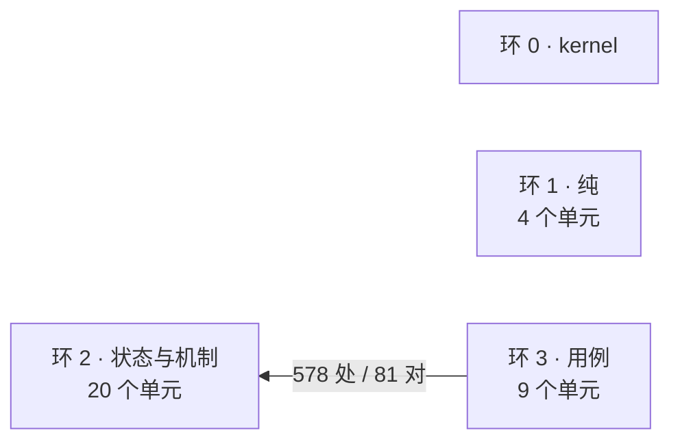

<!-- docs-template: spec -->
# 依赖地图
> 定位：单元之间依赖边的唯一权威：跨环与同环各有哪几条边、各多少处、怎么重算、漂移怎么判。
> 效力：规范｜核对：2026-11-26｜依据：`layers.yaml`、`tests/gates/structure/layers.js`、`tests/gates/structure/graph.js`、`tests/docs-sync.mjs`

## 适用与判据
- 要看「谁依赖谁」读本文；环号、环间规则（H1/H2）与同环 rank 的定义以 [layers.md](layers.md) 为准，本文只把边摊开成可核对的两张表与一张环图。
- 边不是手写的：扫 `src/units/[桶/]<单元>/` 下全部 `.rs`，先剥注释与测试模块，再取 `crate::units::[桶::]<单元>` 引用；同一对单元只记首次命中文件与引用处数（判据 `tests/gates/structure/layers.js` 的 `edgesOf`）。

## 一、环级：跨环只有向内一条路
- 跨环边只许指向严格更低的环（H1）；图与表同源，节点是环、边是本表的聚合（判据 `tests/gates/structure/layers.js` 的 `edgeProblem`）。

<!-- BEGIN:dependency-rings -->

| 从 | 到 | 单元对 | 引用处 |
| --- | --- | --- | --- |
| 环 3 · 用例 | 环 2 · 状态与机制 | 81 | 578 |

> 1 种跨环边、81 对单元、578 处引用；本段由 `tests/gates/structure/layers.js` 现算（`node tests/docs-sync.mjs --write`），不手写。
<!-- END:dependency-rings -->

## 二、同环：没有层，只有先后
- 同环边只许指向 rank 更低的单元，rank 由同环边现算（`ranksOf`），成环即判红；这张表就是 rank 的原料，扇出（引用处数）只回执、不设预算。
- 同环互用只有三种正当处置：合并成一个单元、把被引的形状下沉到环 1、端口反转（内层声明、外层实现）。

<!-- BEGIN:dependency-same -->
| 环 | 从 | 到 | 引用处 |
| --- | --- | --- | --- |
| 环 2 · 状态与机制 | `agentloop` | `tools` | 60 |
| 环 2 · 状态与机制 | `agentloop` | `llm` | 38 |
| 环 2 · 状态与机制 | `agentloop` | `transcript` | 31 |
| 环 2 · 状态与机制 | `agentloop` | `workbench` | 25 |
| 环 2 · 状态与机制 | `agentloop` | `prompt` | 20 |
| 环 2 · 状态与机制 | `tools` | `workbench` | 19 |
| 环 2 · 状态与机制 | `vm` | `sandbox` | 17 |
| 环 2 · 状态与机制 | `agentloop` | `sandbox` | 14 |
| 环 2 · 状态与机制 | `agentloop` | `session_model` | 12 |
| 环 2 · 状态与机制 | `workspace` | `workbench` | 10 |
| 环 2 · 状态与机制 | `provision` | `vm` | 9 |
| 环 2 · 状态与机制 | `turn_state` | `session_model` | 9 |
| 环 2 · 状态与机制 | `versions` | `workbench` | 9 |
| 环 2 · 状态与机制 | `vm` | `catalog` | 9 |
| 环 2 · 状态与机制 | `agentloop` | `catalog` | 7 |
| 环 2 · 状态与机制 | `agentloop` | `residents` | 6 |
| 环 2 · 状态与机制 | `turn_state` | `transcript` | 6 |
| 环 2 · 状态与机制 | `turn_state` | `agentloop` | 6 |
| 环 2 · 状态与机制 | `session_model` | `sandbox` | 4 |
| 环 2 · 状态与机制 | `tools` | `llm` | 4 |
| 环 2 · 状态与机制 | `turn_state` | `workbench` | 4 |
| 环 2 · 状态与机制 | `turn_state` | `catalog` | 4 |
| 环 2 · 状态与机制 | `catalog` | `llm` | 3 |
| 环 2 · 状态与机制 | `provision` | `sandbox` | 3 |
| 环 2 · 状态与机制 | `residents` | `catalog` | 3 |
| 环 2 · 状态与机制 | `turn_state` | `llm` | 3 |
| 环 2 · 状态与机制 | `catalog` | `sandbox` | 2 |
| 环 2 · 状态与机制 | `session_model` | `transcript` | 2 |
| 环 2 · 状态与机制 | `tools` | `catalog` | 2 |
| 环 2 · 状态与机制 | `tools` | `prompt` | 2 |
| 环 2 · 状态与机制 | `transcript` | `tools` | 2 |
| 环 2 · 状态与机制 | `workspace` | `prompt` | 2 |
| 环 2 · 状态与机制 | `tools` | `sandbox` | 1 |
| 环 2 · 状态与机制 | `transcript` | `llm` | 1 |
| 环 2 · 状态与机制 | `turn_state` | `prompt` | 1 |
| 环 2 · 状态与机制 | `turn_state` | `residents` | 1 |
| 环 2 · 状态与机制 | `turn_state` | `sandbox` | 1 |
| 环 2 · 状态与机制 | `turn_state` | `tools` | 1 |
| 环 2 · 状态与机制 | `turn_state` | `workspace` | 1 |
| 环 2 · 状态与机制 | `versions` | `workspace` | 1 |
| 环 3 · 用例 | `runtime` | `turn` | 21 |
| 环 3 · 用例 | `runtime` | `work` | 13 |
| 环 3 · 用例 | `work` | `conversation` | 11 |
| 环 3 · 用例 | `turn` | `conversation` | 9 |
| 环 3 · 用例 | `runtime` | `conversation` | 7 |
| 环 3 · 用例 | `system` | `maintenance` | 6 |
| 环 3 · 用例 | `runtime` | `proxy` | 5 |
| 环 3 · 用例 | `collab` | `conversation` | 4 |
| 环 3 · 用例 | `runtime` | `lifecycle` | 4 |
| 环 3 · 用例 | `runtime` | `maintenance` | 3 |
| 环 3 · 用例 | `lifecycle` | `conversation` | 2 |
| 环 3 · 用例 | `lifecycle` | `collab` | 2 |
| 环 3 · 用例 | `turn` | `collab` | 2 |
| 环 3 · 用例 | `proxy` | `collab` | 1 |
| 环 3 · 用例 | `runtime` | `collab` | 1 |
| 环 3 · 用例 | `work` | `turn` | 1 |

> 56 对同环边；同环没有层，只有先后（rank 由这些边现算），所以这张表就是 rank 的原料。
<!-- END:dependency-same -->

## 三、跨环：每条边都要向内
- 这张表是 H1 的证据面：方向列一律是「外环 → 内环」；出现反向或同环逆序，`tests/gates/structure/layers.js` 直接判红（`node run-tests.js --only=structure/layers` 复现）。
- 纯转发（只 `pub use` 再导出）`edgesOf` 也记，但不算真依赖，只回执。

<!-- BEGIN:dependency-cross -->
| 从 | 到 | 方向 | 引用处 |
| --- | --- | --- | --- |
| `collab` | `transcript` | 环 3 · 用例 → 环 2 · 状态与机制 | 39 |
| `work` | `vm` | 环 3 · 用例 → 环 2 · 状态与机制 | 34 |
| `collab` | `llm` | 环 3 · 用例 → 环 2 · 状态与机制 | 31 |
| `turn` | `turn_state` | 环 3 · 用例 → 环 2 · 状态与机制 | 31 |
| `turn` | `transcript` | 环 3 · 用例 → 环 2 · 状态与机制 | 29 |
| `turn` | `agentloop` | 环 3 · 用例 → 环 2 · 状态与机制 | 25 |
| `collab` | `agentloop` | 环 3 · 用例 → 环 2 · 状态与机制 | 23 |
| `work` | `sandbox` | 环 3 · 用例 → 环 2 · 状态与机制 | 19 |
| `runtime` | `catalog` | 环 3 · 用例 → 环 2 · 状态与机制 | 18 |
| `runtime` | `turn_state` | 环 3 · 用例 → 环 2 · 状态与机制 | 15 |
| `turn` | `catalog` | 环 3 · 用例 → 环 2 · 状态与机制 | 13 |
| `turn` | `session_model` | 环 3 · 用例 → 环 2 · 状态与机制 | 13 |
| `collab` | `prompt` | 环 3 · 用例 → 环 2 · 状态与机制 | 12 |
| `collab` | `tools` | 环 3 · 用例 → 环 2 · 状态与机制 | 11 |
| `runtime` | `agentloop` | 环 3 · 用例 → 环 2 · 状态与机制 | 11 |
| `maintenance` | `catalog` | 环 3 · 用例 → 环 2 · 状态与机制 | 10 |
| `turn` | `llm` | 环 3 · 用例 → 环 2 · 状态与机制 | 9 |
| `work` | `turn_state` | 环 3 · 用例 → 环 2 · 状态与机制 | 9 |
| `runtime` | `tools` | 环 3 · 用例 → 环 2 · 状态与机制 | 8 |
| `runtime` | `session_model` | 环 3 · 用例 → 环 2 · 状态与机制 | 8 |
| `runtime` | `versions` | 环 3 · 用例 → 环 2 · 状态与机制 | 8 |
| `work` | `session_model` | 环 3 · 用例 → 环 2 · 状态与机制 | 8 |
| `work` | `workbench` | 环 3 · 用例 → 环 2 · 状态与机制 | 8 |
| `work` | `catalog` | 环 3 · 用例 → 环 2 · 状态与机制 | 8 |
| `work` | `versions` | 环 3 · 用例 → 环 2 · 状态与机制 | 8 |
| `runtime` | `llm` | 环 3 · 用例 → 环 2 · 状态与机制 | 7 |
| `turn` | `workspace` | 环 3 · 用例 → 环 2 · 状态与机制 | 7 |
| `collab` | `catalog` | 环 3 · 用例 → 环 2 · 状态与机制 | 6 |
| `conversation` | `session_model` | 环 3 · 用例 → 环 2 · 状态与机制 | 6 |
| `system` | `vm` | 环 3 · 用例 → 环 2 · 状态与机制 | 6 |
| `turn` | `tools` | 环 3 · 用例 → 环 2 · 状态与机制 | 6 |
| `work` | `workspace` | 环 3 · 用例 → 环 2 · 状态与机制 | 6 |
| `collab` | `turn_state` | 环 3 · 用例 → 环 2 · 状态与机制 | 5 |
| `collab` | `session_model` | 环 3 · 用例 → 环 2 · 状态与机制 | 5 |
| `lifecycle` | `vm` | 环 3 · 用例 → 环 2 · 状态与机制 | 5 |
| `runtime` | `residents` | 环 3 · 用例 → 环 2 · 状态与机制 | 5 |
| `runtime` | `sandbox` | 环 3 · 用例 → 环 2 · 状态与机制 | 5 |
| `runtime` | `transcript` | 环 3 · 用例 → 环 2 · 状态与机制 | 5 |
| `system` | `catalog` | 环 3 · 用例 → 环 2 · 状态与机制 | 5 |
| `turn` | `sandbox` | 环 3 · 用例 → 环 2 · 状态与机制 | 5 |
| `collab` | `workspace` | 环 3 · 用例 → 环 2 · 状态与机制 | 4 |
| `conversation` | `transcript` | 环 3 · 用例 → 环 2 · 状态与机制 | 4 |
| `turn` | `vm` | 环 3 · 用例 → 环 2 · 状态与机制 | 4 |
| `work` | `transcript` | 环 3 · 用例 → 环 2 · 状态与机制 | 4 |
| `work` | `provision` | 环 3 · 用例 → 环 2 · 状态与机制 | 4 |
| `collab` | `workbench` | 环 3 · 用例 → 环 2 · 状态与机制 | 3 |
| `conversation` | `catalog` | 环 3 · 用例 → 环 2 · 状态与机制 | 3 |
| `lifecycle` | `workbench` | 环 3 · 用例 → 环 2 · 状态与机制 | 3 |
| `lifecycle` | `versions` | 环 3 · 用例 → 环 2 · 状态与机制 | 3 |
| `maintenance` | `sandbox` | 环 3 · 用例 → 环 2 · 状态与机制 | 3 |
| `maintenance` | `vm` | 环 3 · 用例 → 环 2 · 状态与机制 | 3 |
| `runtime` | `workbench` | 环 3 · 用例 → 环 2 · 状态与机制 | 3 |
| `system` | `versions` | 环 3 · 用例 → 环 2 · 状态与机制 | 3 |
| `work` | `agentloop` | 环 3 · 用例 → 环 2 · 状态与机制 | 3 |
| `conversation` | `tools` | 环 3 · 用例 → 环 2 · 状态与机制 | 2 |
| `conversation` | `turn_state` | 环 3 · 用例 → 环 2 · 状态与机制 | 2 |
| `conversation` | `agentloop` | 环 3 · 用例 → 环 2 · 状态与机制 | 2 |
| `conversation` | `llm` | 环 3 · 用例 → 环 2 · 状态与机制 | 2 |
| `conversation` | `prompt` | 环 3 · 用例 → 环 2 · 状态与机制 | 2 |
| `lifecycle` | `turn_state` | 环 3 · 用例 → 环 2 · 状态与机制 | 2 |
| `maintenance` | `provision` | 环 3 · 用例 → 环 2 · 状态与机制 | 2 |
| `proxy` | `transcript` | 环 3 · 用例 → 环 2 · 状态与机制 | 2 |
| `turn` | `workbench` | 环 3 · 用例 → 环 2 · 状态与机制 | 2 |
| `turn` | `prompt` | 环 3 · 用例 → 环 2 · 状态与机制 | 2 |
| `work` | `tools` | 环 3 · 用例 → 环 2 · 状态与机制 | 2 |
| `work` | `llm` | 环 3 · 用例 → 环 2 · 状态与机制 | 2 |
| `lifecycle` | `catalog` | 环 3 · 用例 → 环 2 · 状态与机制 | 1 |
| `lifecycle` | `transcript` | 环 3 · 用例 → 环 2 · 状态与机制 | 1 |
| `lifecycle` | `agentloop` | 环 3 · 用例 → 环 2 · 状态与机制 | 1 |
| `lifecycle` | `residents` | 环 3 · 用例 → 环 2 · 状态与机制 | 1 |
| `lifecycle` | `session_model` | 环 3 · 用例 → 环 2 · 状态与机制 | 1 |
| `lifecycle` | `tools` | 环 3 · 用例 → 环 2 · 状态与机制 | 1 |
| `proxy` | `session_model` | 环 3 · 用例 → 环 2 · 状态与机制 | 1 |
| `proxy` | `tools` | 环 3 · 用例 → 环 2 · 状态与机制 | 1 |
| `runtime` | `prompt` | 环 3 · 用例 → 环 2 · 状态与机制 | 1 |
| `runtime` | `provision` | 环 3 · 用例 → 环 2 · 状态与机制 | 1 |
| `runtime` | `vm` | 环 3 · 用例 → 环 2 · 状态与机制 | 1 |
| `runtime` | `workspace` | 环 3 · 用例 → 环 2 · 状态与机制 | 1 |
| `system` | `provision` | 环 3 · 用例 → 环 2 · 状态与机制 | 1 |
| `system` | `workbench` | 环 3 · 用例 → 环 2 · 状态与机制 | 1 |
| `work` | `prompt` | 环 3 · 用例 → 环 2 · 状态与机制 | 1 |

> 81 对跨环边；方向一律向内（外层 → 内层），向上与同环逆序由 `tests/gates/structure/layers.js` 判红，本表只记现状。
<!-- END:dependency-cross -->

## 检查
- 边与环号、同环 rank、H1 方向 → `node run-tests.js --only=structure/layers`（`tests/gates/structure/layers.js`）。
- 本文三段生成段是否与代码一致（漂移即失败）→ `node tests/docs-sync.mjs`（`--write` 重写；闸门 `node run-tests.js --audit=docs`）。
- 图形版（点节点下钻到文件、点文件看四槽）→ `node tests/gates/structure/graph.js` 生成的仓库根 `Structure.html`，与本文同一次计算。
- kernel 内部的机制边不在这张表里（机制不是单元）→ `docs/kernel/mechanisms.yaml` 与 `tests/gates/structure/kernel-mechanisms.js`。

## 路由
- 四环定义、H1/H2、同环互用的三种处置：[layers.md](layers.md)
- 业务边界判据与 T0 判据清单：[boundaries.md](boundaries.md)
- IO 原语与盘面归属：[io.md](io.md)
